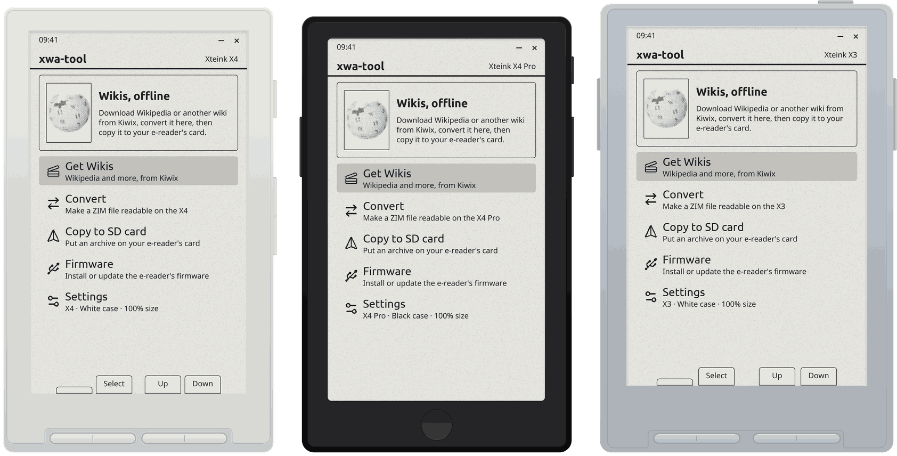
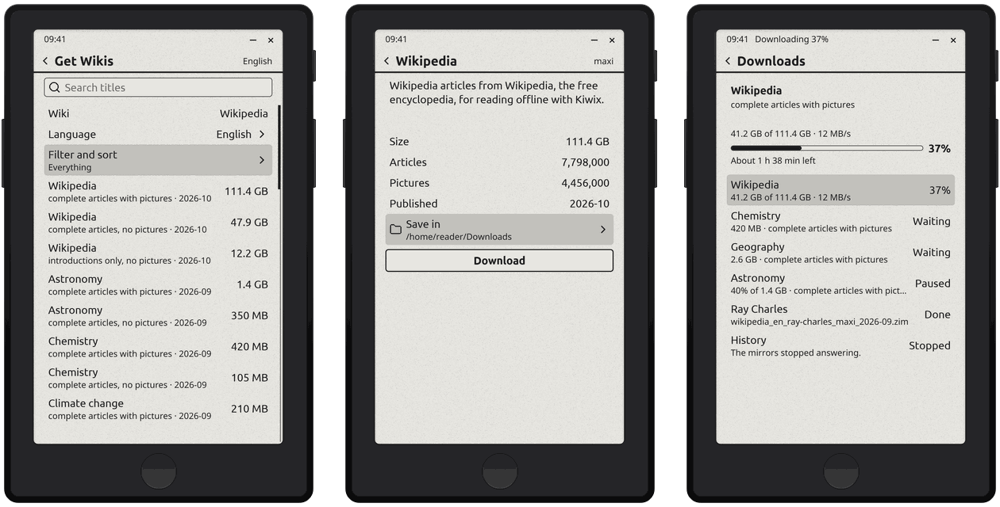
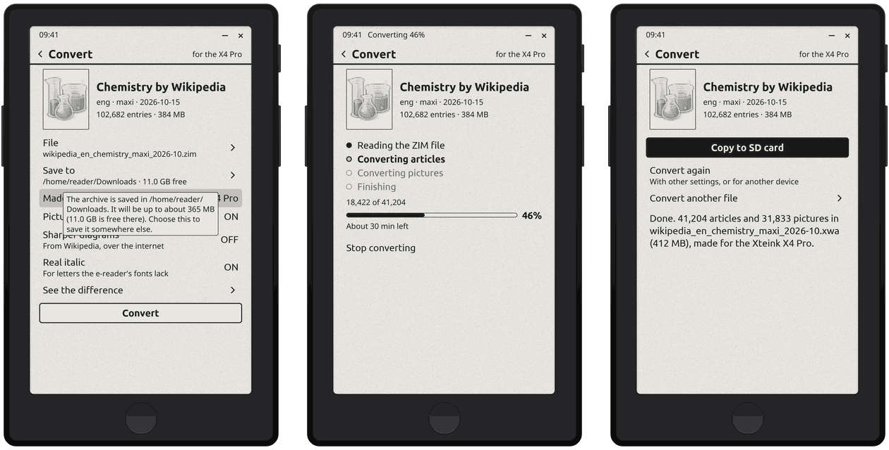
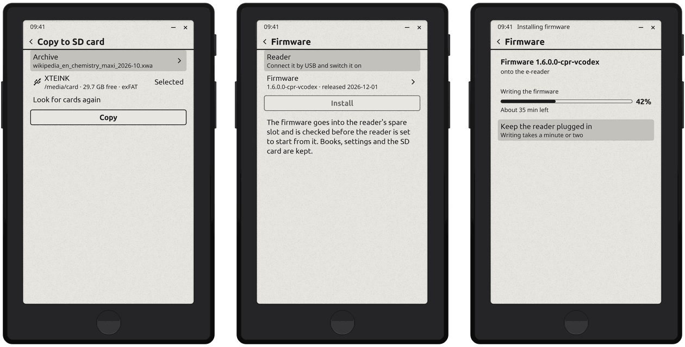
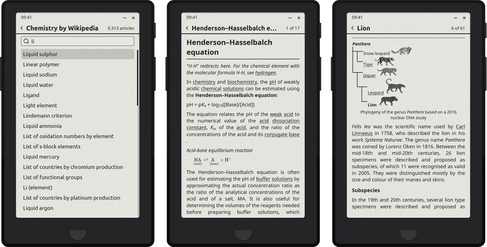

<h1 align="center">xwa-tool</h1>

<p align="center">
  <strong>Wikipedia, and every other Kiwix wiki, offline on your Xteink e-reader.</strong>
</p>

<p align="center">
  <a href="https://github.com/EpicDomi/xwa-tool/actions/workflows/ci.yml"></a>
  <a href="https://github.com/EpicDomi/xwa-tool/releases"></a>
  
  <a href="LICENSE"></a>
</p>

<p align="center">
  
</p>

<p align="center">
  <a href="#getting-started">Getting started</a> ·
  <a href="#the-app">The app</a> ·
  <a href="#whats-in-an-archive">What's in an archive</a> ·
  <a href="#command-line">Command line</a> ·
  <a href="#installing-firmware">Installing firmware</a> ·
  <a href="#building-from-source">Building</a> ·
  <a href="docs/format-spec-v0.md">Format spec</a>
</p>

---

xwa-tool turns [Kiwix](https://kiwix.org) ZIM files into **XWA archives** (`.xwa`), a format made for Xteink e-readers running the [CPR-vCodex wiki firmware](https://github.com/EpicDomi/cpr-vcodex-wiki-x4pro). It does the whole job:

- finds and downloads the wiki you want;
- converts it for your reader, keeping pictures, tables and formulas;
- copies it to the SD card;
- installs or updates the reader's firmware over USB.

It's a desktop app drawn as the e-reader itself, plus a command line that does the same things.

<table>
<tr>
<td width="50%" valign="top">

**📚 Get wikis**<br>
Browse the Kiwix library by language: Wikipedia, Wiktionary, Wikivoyage, Wikibooks, Wikiquote, Wikisource, Wikiversity and Vikidia. Filter, sort, and download with pause and resume.

</td>
<td width="50%" valign="top">

**🔄 Convert**<br>
Articles with their infoboxes, tables, pictures and formulas drawn as real vector math, plus fast search, *On this day*, and a font for every script. All of English Wikipedia converts in about two hours.

</td>
</tr>
<tr>
<td width="50%" valign="top">

**💾 Copy to SD card**<br>
Puts the archive in the card's `wiki` folder, after checking free space and FAT32's 4 GB file limit.

</td>
<td width="50%" valign="top">

**⚡ Firmware**<br>
Installs the latest firmware release over USB, safely: the firmware it replaces stays in the reader's other slot.

</td>
</tr>
<tr>
<td width="50%" valign="top">

**📖 Read**<br>
Opens an archive in the app and shows its articles in pages, as the reader does: search, follow links, and check pictures, tables, formulas and cladograms before copying it to the card.

</td>
<td width="50%" valign="top">

</td>
</tr>
</table>

## Getting started

### 1. Download

Get the zip for your system from the [**latest release**](https://github.com/EpicDomi/xwa-tool/releases):

| System | Download |
|---|---|
| **Windows** (64-bit) | `xwa-tool-windows-x86_64.zip` |
| **macOS** (Apple silicon and Intel) | `xwa-tool-macos-universal.zip` |
| **Linux** (x86-64) | `xwa-tool-linux-x86_64.zip` |

There's nothing to install. Unzip it and run **`xwa-tool-gui`**, the app; `xwa-tool` is the command line. Each zip also carries `THIRD-PARTY-LICENSES.txt`.

> [!NOTE]
> **macOS** builds are made by CI but haven't yet been tried on a Mac. Reports are very welcome. The app isn't signed, so the first time, right-click it and choose **Open**, or allow it under **System Settings › Privacy & Security**.

### 2. Make an archive

1. **Get Wikis**: pick a language and a wiki, then download it. Or use a ZIM you already have.
2. **Convert**: choose the reader it's for and press **Convert**.
3. **Copy to SD card**: put the card in your computer, or connect the reader, and copy.

On the reader, the archive is in the card's `wiki` folder.

### 3. Keep the reader up to date

Connect the reader by USB, open **Firmware** on the home screen and press **Install**. [How it works](#installing-firmware).

## The app

The window *is* the reader: an X4 Pro, X4 or X3, in a black or white case. Its screen looks like e-ink and uses the firmware's own menus, fonts and icons. Rest the pointer on a row whose purpose isn't obvious to see what it does.

<p align="center">
  
</p>

**Get Wikis** lists the Kiwix library by language. You can filter it (with or without pictures, the whole wiki or a topic selection, complete articles or introductions only) and sort it (by title, size, date or number of articles). Downloads queue up, show their speed and time left, and can be paused, resumed or removed. If interrupted, they resume where they stopped, trying the next mirror when one fails, and every file is checked against its SHA-256.

<p align="center">
  
</p>

**Convert** takes a ZIM you downloaded, chose, or dropped onto the window:

- **Save to** shows where the archive goes (the folder you used last, otherwise the ZIM's) and the free space there. It asks before replacing an archive, or when the archive may not fit; the size estimate comes from sampling the ZIM.
- **Made for** chooses the reader. The X4 Pro's archives use stronger compression, which the X4 and X3 can't read.
- **Pictures** can be left out for a far smaller archive.
- **Sharper diagrams** fetches crisper diagrams from Wikipedia (see below).
- **Real italic** stores true italic letters for scripts the reader's fonts lack; *See the difference* shows pictures of both.

<p align="center">
  
</p>

**Copy to SD card** puts an archive on a card. If an archive was converted offline and is missing some glyphs, it offers to complete its font in place.

<p align="center">
  
</p>

**Read** opens an archive (the one you just made, or any other) and shows it as the reader would.
- **Search** lists titles as you type, the most popular first.
- **Ways in:** *Main page*, *On this day* and *Random article*.
- **Pages:** articles are laid out in pages at the reader's size with the reader's font (Noto Sans). The arrow keys or the scroll wheel turn them, and *Contents* jumps to a section. Contents also lists the article's "Part of a series" sidebars, each opening a list of its articles.
- **What's drawn:** formulas are vector math, characters the reader's fonts lack come from the archive's own font, and cladograms draw as trees with their pictures.
- **Links:** clicking one opens its article at the right section, and *Back* returns to where you were.
- **Wide tables:** a table too wide for the page opens on its own screen, where it scrolls both ways.

**Firmware** installs the latest firmware release, or another you choose, on the reader connected by USB ([details](#installing-firmware)).

**Settings** has the device, the case colour, the display size, how the window is drawn, the e-ink refresh flash, fonts for converting offline, the download folder, and *Allow other firmware*.

<details>
<summary><strong>Keys, mouse and window</strong></summary>

<br>

Everything can be clicked, and the device's own keys work too:

| On the device | On the keyboard | Does |
|---|---|---|
| Page keys | Page Up / Page Down | Turn pages |
| Front keys (X4, X3) | ← → or ↑ ↓, Enter, Esc | What the labels above them say |
| Home key (X4 Pro) | Home | Go to the home screen |
| Power key, or – and × on the screen | | Sleep (minimise) or turn off (quit) |
| | Ctrl (⌘) with + / − | Make the device bigger or smaller |
| | Ctrl (⌘) 0 | Fit it to the screen |

Drag the device by its case to move it, or by its edges and corners to resize it.

If the window fails to draw, the app starts again and draws it another way:

- **Windows:** DirectX 12, then Vulkan, OpenGL and software.
- **Linux:** Vulkan, OpenGL and software.
- **Mac:** Metal, then software.

It keeps whichever way works, and Settings can pick one. On Windows the window is the device's own shape when DirectX 12 draws it (through DirectComposition, for which iced is patched, see [`vendor/README.md`](vendor/README.md)), and a rounded rectangle otherwise.

</details>

## What's in an archive

An XWA archive holds a whole wiki in one file, laid out so the reader can open any article and search millions of titles quickly. The [format specification](docs/format-spec-v0.md) describes every byte.

- **Articles:** paragraphs, headings, lists, tables with captions, infoboxes, cladograms (family trees of species, with their links and pictures), and the links of "Part of a series" sidebars, for the reader's article menu. Tick and cross pictures become ✓ and ✗, so comparison tables read right even in wikis without pictures. Navigation boxes, citation markers, reference lists and external-link lists are left out.
- **Links:** links lead to the right article, and to the right section of it. Redirects become searchable alternative titles, including redirects to a section.
- **Search:** title search ignores case and accents in every language, and ranks results by popularity.
- **Pictures:** photos are stored as greyscale JPEG. Diagrams, line art and icons are stored as lossless four-grey line art. Each picture is stored once, however often it's used.
- **Formulas:** formulas are drawn as vector math, with KaTeX's layout and fonts, so they stay sharp at any size. The few KaTeX can't lay out, such as chemistry's `\ce`, become text with real superscripts and subscripts.
- **On this day:** Wikipedia archives say which article belongs to each day of the year, in every language Wikipedia has.
- **A font for every script:** characters the reader's fonts lack (Greek, IPA, Arabic, Chinese, symbols and so on) get outline glyphs from the Noto fonts, including real bold and italic.
  - The fonts are downloaded the first time they're needed and kept.
  - *Fonts for converting offline* in Settings (or `xwa-tool download-fonts`) downloads them all in advance, about 120 MB.
  - An archive converted offline can be completed later.
- **Sharper diagrams:** optionally, the ZIM's small pictures of diagrams are replaced with 800-pixel renderings from Wikimedia.
  - Wikimedia is asked politely: a few requests at a time, waiting whenever it says so.
  - The downloads are kept, so converting again downloads nothing.

<details>
<summary><strong>Sizes and speed</strong></summary>

<br>

Measured on English Wikipedia ZIMs, with pictures and drawn formulas:

| ZIM | Articles | Pictures | ZIM size | X4 Pro archive | X4 / X3 archive | Time |
|---|--:|--:|--:|--:|--:|--:|
| Top 100 | 101 | 3,098 | 333 MB | 39.7 MB | 40.1 MB | 6 s |
| Chemistry | 9,313 | 28,649 | 384 MB | 164.4 MB | 172.4 MB | 48 s |
| Mathematics | 23,255 | 42,673 | 996 MB | 256.3 MB | 274.7 MB | 94 s |
| **All of English Wikipedia** | **7,230,516** | **7,671,740** | **127.4 GB** | **87.5 GB** | | **≈ 2 h 10 min** |

The first three were timed on 4 cores, and all of English Wikipedia (the "maxi" ZIM, read from an SD card) on a laptop. Nearly every formula is drawn as math: 646,177 of mathematics' 646,347, and 19,687 of chemistry's 21,776, where most of the rest are chemical equations. Without pictures, the first three archives are 2.2, 27.2 and 71.6 MB for the X4 Pro.

Memory stays modest whatever the wiki's size: titles are sorted on disk in batches, and the converter keeps 12 bytes per page.

- Swedish Wikipedia (the 4.0 GB "mini" ZIM: 2.6 million articles) converts in under 10 minutes with at most 335 MB of memory.
- English Wikipedia maxi peaks at about 1.4 GB of memory.

Temporary files go next to the archive and disappear once it's written.

</details>

## Command line

`xwa-tool` does everything the app does, plus tools for looking inside ZIM and XWA files.

```sh
# Find and download wikis
xwa-tool catalog                                           # English Wikipedia ZIMs in the Kiwix library
xwa-tool catalog --lang fra --search medecine
xwa-tool catalog --languages
xwa-tool download wikipedia_en_ray-charles --flavour maxi --dir ~/Downloads

# Convert
xwa-tool convert wikipedia_en_100_2026-08.zim              # for the X4 Pro
xwa-tool convert wikipedia_en_100_2026-08.zim --device x4  # for the X4 or X3
xwa-tool convert wikipedia_en_100_2026-08.zim --no-images  # text only

# Copy to the SD card
xwa-tool copy wiki.xwa                                     # to the card's wiki folder, if one card is in
xwa-tool copy wiki.xwa --to /media/me/SDCARD               # into /media/me/SDCARD/wiki

# Install firmware
xwa-tool flash --list                                      # firmware releases, and readers connected
xwa-tool flash                                             # the latest release, onto the reader on USB
xwa-tool flash --file firmware.bin --any-firmware          # any firmware file
```

<details>
<summary><strong>Conversion options</strong></summary>

<br>

| Option | Does |
|---|---|
| `--device x4-pro \| x4 \| x3` | The reader the archive is for (default `x4-pro`) |
| `--no-images` | Leave pictures out |
| `--jpeg-quality N` | Photo quality, trading against size (default 75) |
| `--hd-diagrams` | Sharper diagrams from Wikimedia; kept in the cache (`--hd-cache DIR` to choose where) |
| `--math-as-text` | Write formulas as text instead of drawing them |
| `--no-real-italic` | Leave out real italic glyphs; the reader slants the regular ones |
| `--no-fallback-font` | Leave out the fallback font altogether |
| `--font-cache DIR` | Where the Noto fonts are kept |

</details>

<details>
<summary><strong>Looking inside files</strong></summary>

<br>

```sh
xwa-tool info wiki.zim                            # what a ZIM contains
xwa-tool title-index wiki.zim --query "einstein"  # search its titles
xwa-tool info wiki.xwa                            # format, features, sections, metadata
xwa-tool verify wiki.xwa                          # check every checksum, article, link and image
xwa-tool dump wiki.xwa --title "Albert Einstein"  # an article as text
xwa-tool dump wiki.xwa --search "einst" --popular # titles, most popular first
xwa-tool dump wiki.xwa --image 12 --out diagram.pgm
xwa-tool download-fonts                           # every font, for converting offline
xwa-tool complete-font wiki.xwa                   # add the glyphs an offline conversion lacked

# Draw an article's formulas into a web page, to check them
xwa-tool dump wiki.xwa --title "Pythagorean theorem" --formulas page.html
```

`verify` also explains any characters without a glyph: whether a Noto font could add them, or whether no font has them (such as rare CJK ideographs, or code points Unicode hasn't assigned).

</details>

## Installing firmware

xwa-tool installs the reader's firmware over USB the same way the CrossPoint web installer does, with extra checks. Nothing is written until everything checks out:

1. **The reader is recognised.** Its partition table must exactly match the X4, X3 or X4 Pro layout, and its chip must be that model's (ESP32-C3, or ESP32-S3 for the X4 Pro).
2. **The firmware is checked.** It must be a complete, undamaged firmware image for that chip, checked as the reader's bootloader would. Downloaded releases are also checked against the SHA-256 GitHub publishes.
3. **It goes into the spare slot.** The reader has two firmware slots. The new firmware is written to the one not in use and verified there. Only then is the reader set to start from it.

The bootloader, settings, books and SD card are never touched, and the previous firmware stays in the other slot. If the cable comes out halfway, the reader still starts what it had, and you can simply install again.

- **Releases:** by default only the [firmware's own releases](https://github.com/EpicDomi/cpr-vcodex-wiki-x4pro/releases) can be installed. Turn on *Allow other firmware* in Settings (or pass `--any-firmware`) to install any firmware file, such as one you built yourself.
- **Restarting:** the X4 and X3 restart by themselves. The X4 Pro can't be restarted over USB, so unplug it, plug it in again, and hold the power button until it starts.
- **Linux:** using the reader's USB port needs permission. Add yourself to the `dialout` group (`uucp` on Arch) and log in again.

## Where things are kept

| What | Where |
|---|---|
| Settings (`app.txt`, `graphics.txt`), and a `crash.txt` report if the app ever fails | `xwa-tool` in the configuration folder: `%APPDATA%` · `~/.config` · `~/Library/Application Support` |
| Noto fonts (`fonts`) and sharper diagrams (`diagrams`), kept for next time | `xwa-tool` in the cache folder: `%LOCALAPPDATA%` · `~/.cache` · `~/Library/Caches` |
| Downloaded ZIM files | Your Downloads folder, unless you choose another |

Deleting the cache folders is safe; they're filled again when needed.

## Building from source

You need [Rust](https://rustup.rs); `rust-toolchain.toml` picks the exact version.

```sh
cargo build --release
./target/release/xwa-tool-gui     # the app
./target/release/xwa-tool --help  # the command line
cargo test --workspace
```

| Part | What it is |
|---|---|
| [`xwa-zim`](crates/xwa-zim) | ZIM reader: metadata, directory, zstd and XZ clusters |
| [`xwa-format`](crates/xwa-format) | The XWA format: content encoding, title index, writer, reader and verifier. The writer compresses on every core and gives the same bytes for the same input |
| [`xwa-convert`](crates/xwa-convert) | ZIM to XWA: article extraction, pictures, formulas, the fallback font |
| [`xwa-fetch`](crates/xwa-fetch) | The Kiwix catalogue, downloads, SD cards, sharper diagrams, fonts |
| [`xwa-flash`](crates/xwa-flash) | Firmware installation over USB (with [espflash](https://github.com/esp-rs/espflash)) |
| [`xwa-cli`](crates/xwa-cli) | The `xwa-tool` command line |
| [`xwa-gui`](crates/xwa-gui) | The `xwa-tool-gui` app ([iced](https://iced.rs)) |
| [`xtask`](xtask) | `cargo xtask licenses` (the release's third-party notice), `days` (each Wikipedia's day articles, from Wikidata), `fonts` (the Noto font catalogue), `unicode` (code points no font draws) |
| [`docs`](docs) | The [XWA format specification](docs/format-spec-v0.md), and [ideas for later](docs/future.md) |

Every push to `main` builds the Windows, macOS and Linux zips, which are kept as workflow artifacts. Pushing a `v*` tag attaches them to a GitHub release.

## License and credits

xwa-tool is in the **public domain**, under the [Unlicense](LICENSE).

It stands on the work of many others:

- **[Kiwix](https://kiwix.org)** and **[Wikimedia](https://wikimedia.org)** make the ZIM files. The articles in an archive keep their own licences (for Wikipedia, CC BY-SA), and each archive names its source.
- **[KaTeX](https://katex.org)**: its fonts are embedded for drawing formulas (SIL Open Font License).
- **[Noto](https://fonts.google.com/noto)**: the fallback glyphs come from the Noto fonts (SIL Open Font License).
- **[Ubuntu](https://design.ubuntu.com/font)** and Noto Sans draw the app's screen, as on the reader (Ubuntu Font Licence; SIL Open Font License).
- **[CrossPoint Reader](https://github.com/crosspoint-reader/crosspoint-reader)** and **[CPR-vCodex](https://github.com/franssjz/cpr-vcodex)**: the firmware these archives are made for, whose menus and icons the app draws.

The font licences are in [`licenses/`](licenses/). Every other dependency is listed with its licence in `THIRD-PARTY-LICENSES.txt` in each release.
