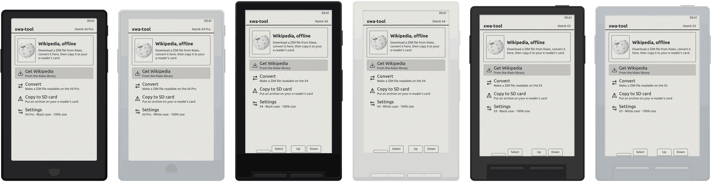
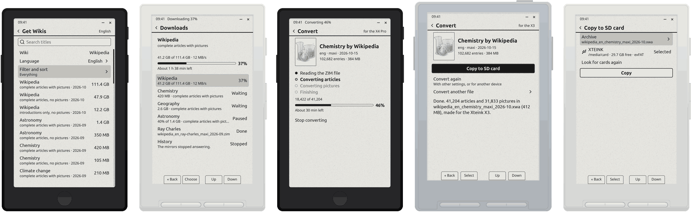

# xwa-tool

Fetch and convert ZIM archives to XWA format for XTEINK devices.

xwa-tool turns Kiwix ZIM archives (Wikipedia first) into XWA archives (`.xwa`
files), a format built for Xteink e-readers running the CPR-vCodex wiki
firmware: the X4 Pro first, the X4 and X3 as far as their memory allows. The
format is described in [`docs/format-spec-v0.md`](docs/format-spec-v0.md).

## Status

Early. What works today:

- `xwa-zim`: a ZIM reader (header, metadata, directory scans and path lookups,
  zstd and XZ clusters, the title listing).
- `xwa-format`: the XWA format, draft v0.3: the article content encoding,
  the title index (case- and accent-insensitive prefix search, folded the
  same way in every language by a table each archive carries, and ranked by
  popularity), and an archive writer, reader and verifier. The writer compresses on every CPU core and
  produces the same bytes for the same input.
- `xwa-convert`: ZIM to XWA conversion of Wikipedia, and of the other
  wikis Kiwix makes the same way (Wiktionary, Wikivoyage, Vikidia and the
  rest): paragraphs,
  headings, lists, tables, infoboxes, links resolved to articles,
  pictures (photos as greyscale JPEG; diagrams, line-art bitmaps and icons
  as lossless 4-grey line art, each picture stored once), and formulas
  drawn as vector math (KaTeX's layout of the LaTeX in the ZIM, with
  KaTeX's fonts; formulas it cannot lay out, such as mhchem's `\ce`, are
  written as text with real superscripts and subscripts). Navigation boxes,
  citation markers, reference lists and external-link lists are left out.
  Redirects, including mwoffliner's redirects to a section, become
  searchable alternative titles. Links to a section of another article,
  and redirects to a section (from links or from search), open the article
  at that section. Wikipedia archives say which article is each day's, for
  the e-reader's "On this day", in all of Wikipedia's languages. Each
  archive carries a fallback font: outlines, from the Noto fonts, of every
  character its text uses that the e-reader's own fonts lack (Greek, IPA,
  symbols, Arabic, Chinese...), with real bold and italic glyphs for the
  text it draws bold or italic. The Noto fonts it needs are downloaded the
  first time and kept; `--no-fallback-font` leaves it out, and
  `--no-real-italic` (in the app: "Real italic", with pictures of the
  difference) leaves out just the italic glyphs, for the e-reader to slant
  the regular ones.
- `xwa-fetch`: the Kiwix library catalog, downloads (resumed after an
  interruption, mirrors tried in turn, checked against their SHA-256), and
  copying archives to SD cards (into the card's `wiki` folder, where the
  e-reader looks for them, with FAT32's 4 GB limit checked first).
- `xwa-tool`: command line with `catalog`, `download`, `convert`, `copy`,
  `info`, `verify`, `dump` and `title-index`.
- `xwa-tool-gui`: a desktop app drawn as the e-reader itself. The window
  is the device (an X4 Pro, X4 or X3, in a black or white case) and its
  screen looks like e-ink and shows the firmware's own menus, fonts and
  icons. "Get Wikis" lists the Kiwix library's wikis (Wikipedia,
  Wiktionary, Wikivoyage, Wikibooks, Wikiquote, Wikisource, Wikiversity and
  Vikidia) by language, filtered (with or without pictures, the whole wiki
  or selections on a topic, complete articles or introductions) and sorted
  (by title, size, date or number of articles). Downloads wait their turn,
  show their speed and the time left, and can be paused, resumed or taken
  off the list; "Downloads" on the home screen shows them. "Convert" takes
  a ZIM (downloaded, chosen, or dropped onto the device) and converts it
  for your e-reader; "Copy to SD card" puts the archive on the card.

  Everything can be clicked, and the device's keys work too: the page keys
  turn pages, the X4's and X3's front keys do what the labels above them
  say, the X4 Pro's Home key goes home, and the power key offers to sleep
  (minimise) or turn off (quit), as do the – and × at the top right of the
  screen. On the keyboard the arrows move, Enter chooses, Esc goes back,
  Page Up and Page Down turn pages, and Ctrl (⌘ on a Mac) with + and −
  changes the size; Ctrl 0 fits it to the screen again. Drag the device by
  its case to move it, or by its edges and corners to resize it. Settings
  has the device, the case colour, the size, how the window is drawn, the
  e-ink refresh flash and the download folder.

  Should the window fail to draw as the app starts, the app starts again
  drawing it another way (on Windows DirectX 12, then Vulkan, OpenGL and
  software; on Linux Vulkan, OpenGL and software; on a Mac Metal, then
  software) and keeps the way that works; Settings can also pick one. On
  Windows the window is the device's own shape when DirectX 12 draws it
  (through DirectComposition, for which iced is patched, see
  [`vendor/README.md`](vendor/README.md)), and a rounded rectangle
  otherwise. A failure leaves a report in `xwa-tool/crash.txt` in the
  configuration folder (`%APPDATA%` on Windows, `~/.config` on Linux,
  `~/Library/Application Support` on a Mac).





## Building

```
cargo build --release
./target/release/xwa-tool convert wikipedia_en_100_2026-08.zim                 # for the X4 Pro
./target/release/xwa-tool convert wikipedia_en_100_2026-08.zim --device x4     # for the X4 or X3
./target/release/xwa-tool convert wikipedia_en_100_2026-08.zim --no-images     # text only
./target/release/xwa-tool-gui
```

`--jpeg-quality` (default 75) trades photo quality for size, and
`--math-as-text` writes formulas as text instead of drawing them.

`--hd-diagrams` (in the app: "Download sharper diagrams from Wikipedia")
replaces the ZIM's small pictures of SVG diagrams with sharper renderings,
800 px on the long side, from Wikimedia's thumbnail service. It needs the
internet and takes longer: requests go a few at a time, at Wikimedia's
standard thumbnail widths, and wait whenever Wikimedia asks. Diagrams it
cannot get keep the ZIM's picture. Downloads are kept in `xwa-tool/diagrams`
in the system's cache folder (or `--hd-cache DIR`), so converting again
downloads nothing; delete that folder to free the space.

`--one-read` (in the app: "Read the ZIM once", off by default) reads the
ZIM's pages once instead of twice, which saves time when the ZIM is on a
slow drive such as an SD card. Until the archive is written, it keeps the
converted articles in a temporary file in the output's folder. That file
holds about a third to three quarters of the ZIM's compressed text. The
archive is the same either way. The app estimates the archive's size plus
that file's, and offers the option only when they fit in the free space
where the archive is saved.

Measured on English Wikipedia ZIMs (4 cores), with pictures and drawn
formulas:

| ZIM | Articles | Pictures | Formulas drawn | ZIM size | X4 Pro archive | X4/X3 archive | Time (X4 Pro) |
|---|---|---|---|---|---|---|---|
| Top 100 | 101 | 3,098 | 5 of 8 | 333 MB | 39.7 MB | 40.1 MB | 6 s |
| Chemistry | 9,313 | 28,649 | 19,687 of 21,776 | 384 MB | 164.4 MB | 172.4 MB | 48 s |
| Mathematics | 23,255 | 42,673 | 646,177 of 646,347 | 996 MB | 256.3 MB | 274.7 MB | 94 s |

Without pictures the same archives are 2.2, 27.2 and 71.6 MB for the X4
Pro. `xwa-tool dump wiki.xwa --title "Pythagorean theorem" --formulas
page.html` draws an article's formulas into a web page, for checking.

Memory use stays small whatever the size of the Wikipedia: titles are
sorted on disk in batches, and the converter keeps 12 bytes per page.
Swedish Wikipedia (the 4.0 GB "mini" ZIM: 5.0 million entries, 2.6 million
articles) converts in 9 min 39 s with at most 335 MB of memory, where it
took 10 min 48 s and 1,430 MB before. A title index the size of English
Wikipedia's (18.5 million titles) builds in 83 MB instead of 3.2 GB.
Temporary files go next to the archive and disappear once it is written.

Getting ZIMs and putting archives on the card:

```
xwa-tool catalog                            # English Wikipedia ZIMs in the Kiwix library
xwa-tool catalog --lang fra --search medecine
xwa-tool catalog --languages
xwa-tool download wikipedia_en_ray-charles --flavour maxi --dir ~/Downloads
xwa-tool copy wiki.xwa                      # to the SD card's wiki folder, if one card is inserted
xwa-tool copy wiki.xwa --to /media/me/SDCARD  # into /media/me/SDCARD/wiki
```

For ZIM and XWA files:

```
xwa-tool info wiki.zim                      # what a ZIM contains
xwa-tool title-index wiki.zim --query "einstein"
xwa-tool info wiki.xwa                      # format, features, sections, metadata
xwa-tool verify wiki.xwa                    # check every checksum, article, link and image
xwa-tool dump wiki.xwa --title "Albert Einstein"
xwa-tool dump wiki.xwa --search "einst"
xwa-tool dump wiki.xwa --search "einst" --popular
xwa-tool dump wiki.xwa --image 12 --out diagram.pgm
```

Pushing a `v*` tag builds Windows, macOS and Linux binaries and attaches them
to a GitHub release, each zip with a `THIRD-PARTY-LICENSES.txt` that lists
every crate in the programs with its licence text. `cargo xtask licenses`
writes the same file locally. `cargo xtask days` refreshes the table of each
Wikipedia's day articles from Wikidata, and `cargo xtask fonts` the catalogue
of Noto fonts the fallback font is drawn from.

## License

Public domain, via the [Unlicense](LICENSE). Third-party dependencies keep
their own licenses (see `THIRD-PARTY-LICENSES.txt` in each release); xwa-tool
embeds KaTeX's fonts, which are under the SIL Open Font License (see
[`licenses/`](licenses/)).
